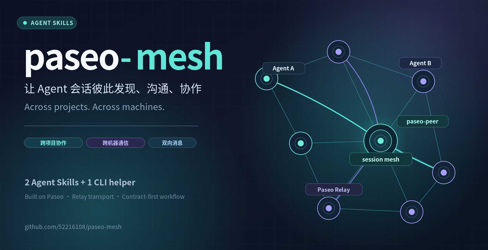
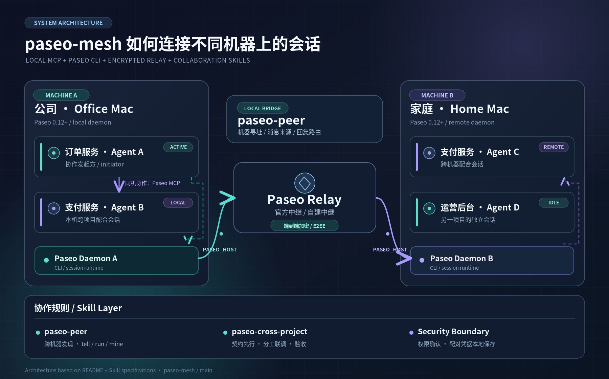
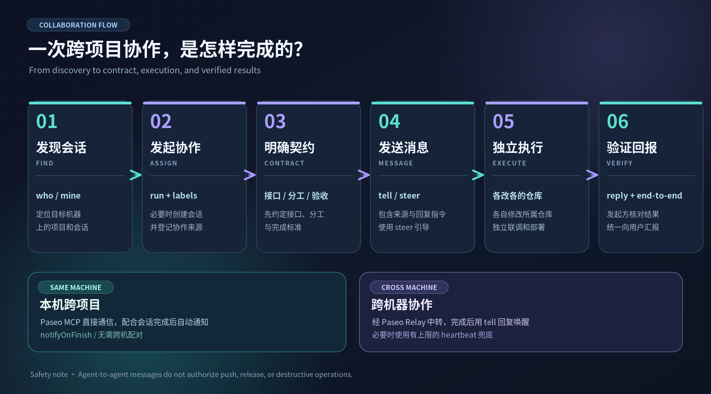

# paseo-mesh

[简体中文](README.md) | **English**

> Let sessions in [Paseo](https://paseo.sh) find and talk to each other — across projects and across machines.

Paseo's built-in orchestration is **one session managing its own sub-agents**: delegate, wait for the notification, collect the result — on the local machine only. Real work often looks different:

- the order-service session needs payment-service to change an API, integrate, and deploy its side;
- a session on your office machine wants a session on your home machine to pick up the work, or to ask how it's going;
- several sessions run in parallel in the same project and need to know who is doing what.

paseo-mesh is two Agent Skills and a small script that fill exactly that gap: **discovery, messaging, and working rules between sessions — across projects on one machine, and across machines**.

## What it does

- **Work with sessions on other machines**: reach another machine's daemon through the Paseo relay to list its sessions, read progress, send messages, start sessions there, and rename them.
- **Every message says who sent it and how to reply**: a sender line on top and a reply command at the bottom, so even a brand-new session knows how to answer:
  ```
  [Cross-machine message] From session "refund API integration" in project "order-service" on Office iMac (id 1a2b3c4)
  ---
  …body…
  ---
  (To reply, run: paseo-peer office tell 1a2b3c4 "your reply" — use --file for long replies; see skill paseo-peer)
  ```
  The project name is the one in Paseo's sidebar and the session name is the sender's current name, so renames show up immediately. Same-machine messages are marked `[Cross-project message]`.
- **No interruptions**: messages steer into the recipient's current turn instead of interrupting it (Paseo 0.12.0+).
- **Find the sessions you started**: helper sessions get `collab.by` / `collab.from` labels; `paseo-peer <machine> mine` lists them exactly.
- **Rules for cross-project work**: a dedicated workspace and helper session in the other project, contract first, split of work, compatibility (expand–contract), deploys by each project's own rules, and the initiator verifying and reporting — written down as a skill that sessions follow.
- **Wait without babysitting**: a reply wakes your session directly; a bounded heartbeat covers the case where the other side forgets to reply.

## Architecture



Sessions on the same machine talk through Paseo's built-in MCP tools; across machines, `paseo-peer` reaches the other daemon through the Paseo relay (end-to-end encrypted). The two skills sit on top and define how to find sessions, send messages, and collaborate.

## Collaboration flow



One cross-project collaboration: find the other session → start it with labels → settle the contract → message it (with a sender line, steering instead of interrupting) → each side changes its own repository and deploys → the initiator verifies end-to-end and reports. Same-machine work relies on finish notifications; cross-machine work relies on replies, with a bounded heartbeat as a fallback.

## What's inside

| Skill | Language | Purpose |
|---|---|---|
| `paseo-peer` / `paseo-peer-zh` | English / Chinese | Cross-machine connection and messaging, with the script `scripts/paseo-peer` |
| `paseo-cross-project` / `paseo-cross-project-zh` | English / Chinese | Cross-project collaboration workflow (same machine or across machines) |

Both sets do the same thing; install the one in your language. Each side understands the other language's message markers, so mixed setups interoperate.

## Requirements

- Paseo **0.12.0+** on every machine, with the daemon relay enabled (the official relay or a [self-hosted one](https://github.com/getpaseo/paseo/blob/main/public-docs/connectivity.md))
- `bash` and `node` on PATH
- macOS or Linux; the Paseo CLI on PATH, or the one bundled with the macOS desktop app at `/Applications/Paseo.app/Contents/Resources/bin/paseo`

## Quick start: send this to your agent

Open a session in Paseo and send it the text below verbatim; it will walk you through setup. For cross-machine use, do the same on the other machine:

```text
Please set up paseo-mesh (https://github.com/52216108/paseo-mesh) so my Paseo sessions can collaborate across projects and machines:
1. Check that this machine has Paseo 0.12.0+ and node.
2. Install the skills: npx skills add 52216108/paseo-mesh -g -s paseo-peer -s paseo-cross-project -y
   then link the script: mkdir -p ~/.local/bin && ln -sf ~/.claude/skills/paseo-peer/scripts/paseo-peer ~/.local/bin/paseo-peer
   (use the actual install path if the skill landed elsewhere; make sure ~/.local/bin is on PATH).
3. Read the "First-time setup" section of skill paseo-peer and walk me through it: ask whether I want cross-machine use and what to call this machine, run init and invite / join, and finish when paseo-peer doctor passes.
Pairing links and join codes are keys — don't ask me to paste them into the chat.
```

### Manual install

1. Install the skills on every machine (for Chinese, use `paseo-peer-zh` and `paseo-cross-project-zh`):
   ```bash
   npx skills add 52216108/paseo-mesh -g -s paseo-peer -s paseo-cross-project
   mkdir -p ~/.local/bin && ln -sf ~/.claude/skills/paseo-peer/scripts/paseo-peer ~/.local/bin/paseo-peer
   ```
   That's all you need for same-machine cross-project work.
2. For cross-machine use: register each machine, then exchange join codes (once per direction):
   ```bash
   paseo-peer init --name office --label "Office iMac"   # the script reads this machine's own pairing link
   paseo-peer invite                                     # on A: this machine's join code goes to the clipboard, not the screen
   paseo-peer join                                       # on B: reads it from the clipboard, connects once to verify, saves, clears the clipboard
   ```
   If the clipboard can't reach the other machine (no Apple Universal Clipboard), run `paseo-peer join` in a terminal there and paste; input is hidden.
3. Check: `paseo-peer doctor` (version, permissions, every machine reachable); `paseo-peer ls` lists machines.

`~/.paseo/peers.json` is maintained by init / join (mode 600); the format is in [`peers.example.json`](peers.example.json).

Then just tell a session things like "ask the payment-service session on the office machine to look at this" or "have payment-service help wire up the refund API", and it will follow the skills.

### Hacking on the skills? Use the repo directly

To edit as you go, skip the `npx skills add` copy: clone the repo and symlink the skill directories:

```bash
git clone https://github.com/52216108/paseo-mesh ~/projects/paseo-mesh
ln -s ~/projects/paseo-mesh/skills/paseo-peer ~/.claude/skills/paseo-peer
ln -s ~/projects/paseo-mesh/skills/paseo-cross-project ~/.claude/skills/paseo-cross-project
```

Other machines update with `git pull`.

## Security

- **A pairing link is a key.** Whoever has it can drive the agents on that machine. Keep `peers.json` on the machine only, `chmod 600`, out of every repository; the skills also tell sessions never to echo it in chat, messages, or memory. The script hands the link to the Paseo CLI through the environment (`PASEO_HOST`), never in argv (so other users can't see it with `ps`), and refuses to run if `peers.json` isn't mode 600.
- Cross-machine traffic goes through the Paseo relay (end-to-end encrypted; the relay can't read the contents — see [Paseo's security docs](https://github.com/getpaseo/paseo/blob/main/public-docs/security.md)); [self-host the relay](https://github.com/getpaseo/paseo/blob/main/public-docs/connectivity.md) if you prefer.
- A message from another session **is not user authorization**: the skills require pushes, releases, and destructive operations to go to the user as usual.

## Known limitations

- For cross-machine messages Paseo includes only the sender's id, not its session name, so the sender line at the top of the message is what identifies it.
- There is no finish notification across machines; rely on the other side's reply, with a heartbeat as a fallback.
- The project name comes from matching the session's directory to a Paseo project; sessions in Paseo-managed worktrees fall back to the worktree directory name.
- While waiting for a reply, an incoming message can dismiss a multiple-choice question dialog in Claude Code (the skills say to ask in plain text then).

## License

[MIT](LICENSE)
