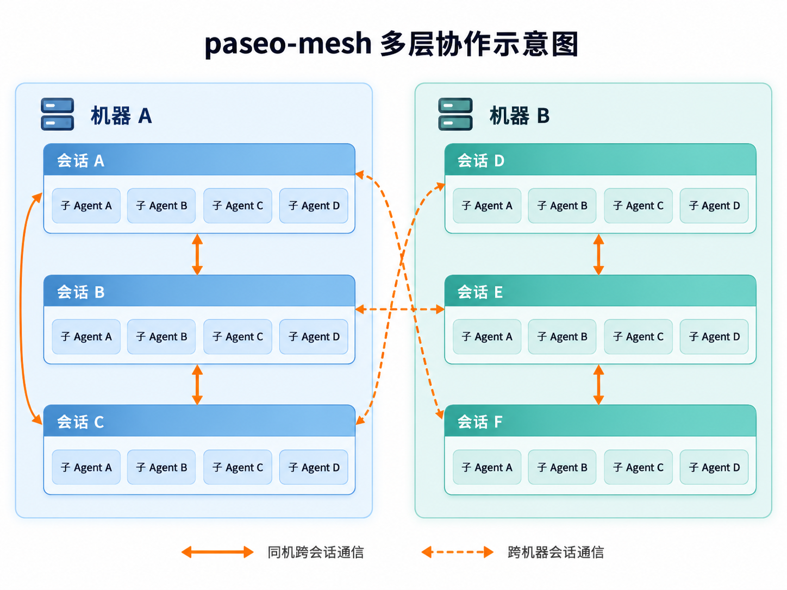

# paseo-mesh

**简体中文** | [English](README.en.md)

> 让 [Paseo](https://paseo.sh) 里的会话互相找到、互相说话——跨项目，也跨机器。

Paseo 自带的编排能力，是**一个会话管它自己的子 agent**：派活、等通知、收结果，而且只在本机。真实的工作往往不是这样：

- 订单服务的会话需要支付服务那边配合改接口、联调、各自部署；
- 公司那台机器上的会话，要让家里那台机器上的会话接着干，或者问它进度；
- 同一个项目里并行着好几个会话，彼此需要知道谁在做什么。

paseo-mesh 是两个 Agent Skill 加一个小脚本，补上的就是这块：**会话与会话之间（同机跨项目、跨机器）的发现、通信与协作规矩**。



## 能做什么

- **跨机器操作会话**：经 Paseo 中继连到另一台机器的 daemon，看它有哪些会话、读进度、发消息、在那边新开会话、改名。
- **消息自带「我是谁、怎么回」**：每条消息开头写明来源，末尾附回复命令，对方即使是刚开的新会话也知道怎么回：
  ```
  【跨机器消息】来自 公司的 iMac 上「订单服务」项目的会话「退款接口打通」（id 1a2b3c4）
  ---
  ……正文……
  ---
  （回复请运行：paseo-peer office tell 1a2b3c4 "回复内容"，长回复用 --file；用法见 skill paseo-peer-zh）
  ```
  项目名直接取 Paseo 侧边栏里的项目名，会话名取发送方当前的会话名，改名即生效；同机跨项目标为【跨项目消息】。
- **不打断对方**：消息引导（steer）进对方正在跑的这一轮，而不是打断它（Paseo 0.12.0+）。
- **一次查清谁在做什么**：`paseo-peer <机器> find 部署 deploy` 搜遍全部会话最近的消息和执行的命令，不用逐个发消息去问。
- **找得回自己开的会话**：开配合会话时自动打 `collab.by` / `collab.from` 标签，`paseo-peer <机器> mine` 一次精确找回。
- **跨项目协作的规矩**：在对方项目开专门工作区和配合会话、契约先行、分工、兼容性（扩展-收缩）、部署按各自项目规则、发起方统一核对与汇报——写成 skill，会话照着做。
- **等回复不空等**：Paseo 0.13+ 把另一台机器 `paseo-peer link` 成连接主机后，跨机器开的会话每轮做完，完成通知直接回到你的会话（带对方最后的回复）；没 link 时靠对方回复唤醒你，用有上限的 heartbeat 兜底。

## 系统架构


同一台机器上的会话用 Paseo 自带的 MCP 工具直接通信；跨机器时，`paseo-peer` 经 Paseo 中继（端到端加密）连到对方的 daemon。两个 skill 在此之上规定怎么找会话、怎么发消息、怎么协作。

## 协作流程


一次跨项目协作：找到对方会话 → 发起并打标签 → 先定契约 → 发消息（带来源、引导不打断）→ 各改各的仓库、各自部署 → 发起方端到端核对后统一汇报。同机和已 link 的跨机器都靠完成通知；没 link 的跨机器靠对方回复，必要时用有上限的 heartbeat 兜底。

## 包含什么

| Skill | 语言 | 作用 |
|---|---|---|
| `paseo-peer-zh` / `paseo-peer` | 中文 / English | 跨机器连接与通信，含脚本 `scripts/paseo-peer` |
| `paseo-cross-project-zh` / `paseo-cross-project` | 中文 / English | 跨项目协作流程（同机或跨机） |

中英两套功能相同，按你的语言装一套即可；两种语言的消息标记双方都认，混用也能互通。

Paseo 插件（每轮生成速度 `turn-speed`、限额具体刷新时刻 `usage-reset` 等）已拆到独立仓库 [paseo-plugins](https://github.com/52216108/paseo-plugins)。

## 环境要求

- Paseo **0.12.0+**（每台机器），daemon 开启中继（官方中继或[自建中继](https://github.com/getpaseo/paseo/blob/main/public-docs/connectivity.md)）
- PATH 里有 `bash` 和 `node`
- macOS 或 Linux；Paseo CLI 在 PATH 里，或使用 macOS 桌面版自带的 `/Applications/Paseo.app/Contents/Resources/bin/paseo`

## 快速开始：把这段话发给你的 Agent

在 Paseo 里开一个会话，把下面这段原样发过去，它会一步步带你配置；要跨机器的话，另一台机器上也发一次：

```text
请帮我配置 paseo-mesh（https://github.com/52216108/paseo-mesh），让我的 Paseo 会话能跨项目、跨机器协作：
1. 确认本机有 Paseo 0.12.0+ 和 node；
2. 安装中文版 skill：npx skills add 52216108/paseo-mesh -g -s paseo-peer-zh -s paseo-cross-project-zh -y
   然后建链接 mkdir -p ~/.local/bin && ln -sf ~/.claude/skills/paseo-peer-zh/scripts/paseo-peer ~/.local/bin/paseo-peer
   （skill 实际装在别处的话按实际路径链接；确认 ~/.local/bin 在 PATH 里）；
3. 读 skill paseo-peer-zh 的「首次配置」一节，按它一步步引导我：问我要不要跨机器、本机叫什么名字，帮我 init、invite / join，最后 paseo-peer doctor 全部通过。
配对链接和加入码是钥匙，不要让我贴进对话。
```

### 手动安装

1. 每台机器安装 skill（英文版把名字换成 `paseo-peer`、`paseo-cross-project`）：
   ```bash
   npx skills add 52216108/paseo-mesh -g -s paseo-peer-zh -s paseo-cross-project-zh
   mkdir -p ~/.local/bin && ln -sf ~/.claude/skills/paseo-peer-zh/scripts/paseo-peer ~/.local/bin/paseo-peer
   ```
   只在本机做跨项目协作的话，到这里就够了。
2. 要跨机器：每台机器登记自己，然后互相交换加入码（每个方向一次）：
   ```bash
   paseo-peer init --name office --label "公司的 iMac"   # 本机的配对链接脚本自己读取
   paseo-peer invite                                     # A 上：本机加入码进剪贴板，不显示
   paseo-peer join                                       # B 上：从剪贴板读入，实际连一次验证后才保存，并清空剪贴板
   ```
   剪贴板到不了另一台机器时（没有 Apple 通用剪贴板），在那台机器的终端里运行 `paseo-peer join` 直接粘贴，输入不回显。
3. 那台机器的 daemon 设了密码时（Paseo 0.13 起中继连接也要密码），在终端里运行 `paseo-peer password <机器>` 输入一次（不回显）。
4. 两边都是 Paseo 0.13+ 时，各跑一次 `paseo-peer link`，把其他机器登记成本机的连接主机，跨机器才有完成通知。
5. 检查：`paseo-peer doctor`（版本、权限、每台机器能否连上、是否已是连接主机），`paseo-peer ls` 列出机器。

`~/.paseo/peers.json` 由 init / join 自动维护（权限 600），格式见 [`peers.example.json`](peers.example.json)。

之后在会话里直接说「让公司那台机器上做支付服务的会话看一下这个问题」「让支付服务配合把退款接口打通」，会话就会按 skill 来做。

### 自己改 skill？直接用仓库

想边用边改的话，不必用 `npx skills add` 的副本，把仓库克隆下来，再把 skill 目录链接进去：

```bash
git clone https://github.com/52216108/paseo-mesh ~/projects/paseo-mesh
ln -s ~/projects/paseo-mesh/skills/paseo-peer-zh ~/.claude/skills/paseo-peer-zh
ln -s ~/projects/paseo-mesh/skills/paseo-cross-project-zh ~/.claude/skills/paseo-cross-project-zh
```

其他机器 `git pull` 即更新。

运行测试：`npm test`（即 `node --test 'test/*.test.mjs'`，Node 22+，零依赖）。端到端测试会在临时目录起两个真实 Paseo daemon（不连中继、不碰 `~/.paseo` 里的 daemon），用不调模型的回声 provider 覆盖 `find` / `tell` / `link`；需要装好 Paseo（CLI 路径可用 `PASEO_BIN` 覆盖），`link` 测试还需要已装好的同版本 SDK（`~/.paseo/paseo-mesh-sdk`，或用 `PASEO_PEER_SDK` 指定），缺了就跳过。

## 安全

- **配对链接 = 钥匙**。拿到它的人可以操控那台机器上的 agent。`peers.json` 只放本机、`chmod 600`、不进任何仓库；skill 也要求会话不在对话、消息、记忆里回显它。脚本把链接经环境变量（`PASEO_HOST`）交给 Paseo CLI，不出现在命令行参数里（其他系统用户用 `ps` 看不到）；`peers.json` 权限不是 600 时脚本拒绝运行。
- 跨机器流量经 Paseo 中继转发（端到端加密，中继读不到内容，见 [Paseo 安全文档](https://github.com/getpaseo/paseo/blob/main/public-docs/security.md)）；对中继有顾虑可以[自建中继](https://github.com/getpaseo/paseo/blob/main/public-docs/connectivity.md)。
- 来自其他会话的消息**不等于用户授权**：skill 要求推送、发布、破坏性操作照常找用户确认。

## 已知限制

- 跨机器发来的消息，Paseo 只带发送方 id、不带会话名，所以来源靠消息开头那一行辨认。
- 跨机器完成通知需要两边都是 Paseo 0.13+ 且已 `paseo-peer link`。等待中的通知存在本机 daemon 的磁盘上，本机 daemon 重启后会恢复；对方会话停在权限请求时也会通知你（带请求内容，可以远程批准）。对方连续三次连不上时，你会收到一条「状态未知、订阅已结束」的通知，这时查一次对方状态，必要时再挂 heartbeat。没 link 时靠对方回复或 heartbeat 兜底。
- 项目名按会话所在目录匹配 Paseo 项目；开在 Paseo 管理的 worktree 里的会话，项目名会退回 worktree 目录名。
- 等对方回复期间，对方消息进来可能打断 Claude Code 的选择题对话框（skill 里已要求此时用文字提问）。

## 许可

[MIT](LICENSE)
